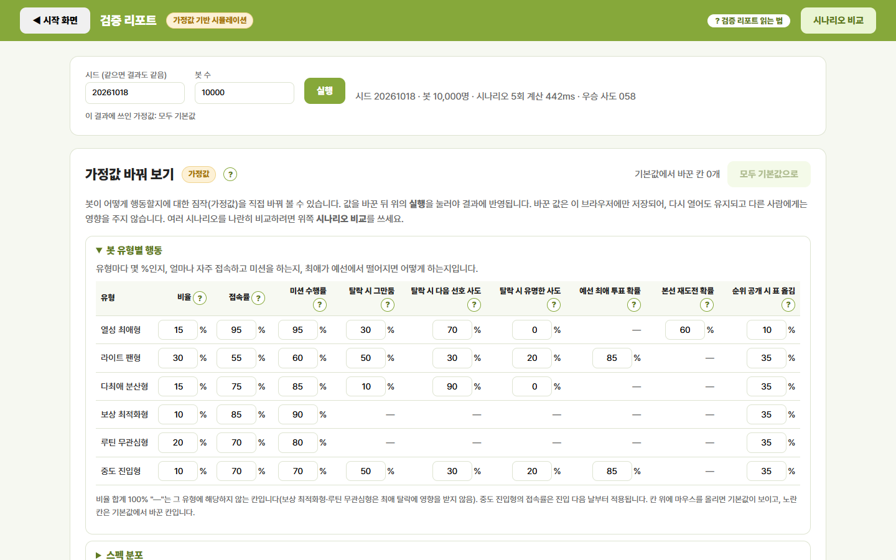
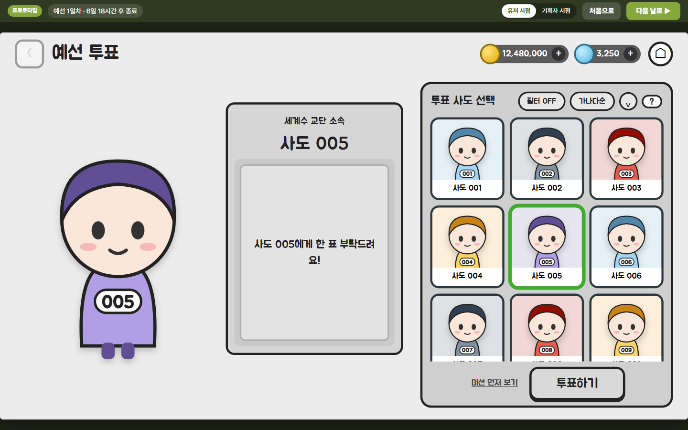
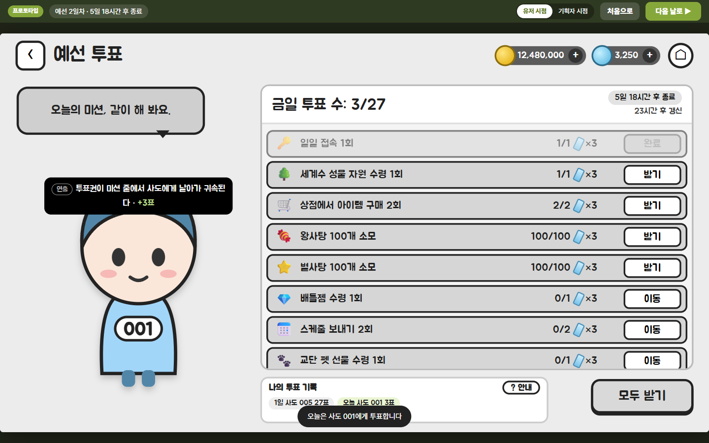
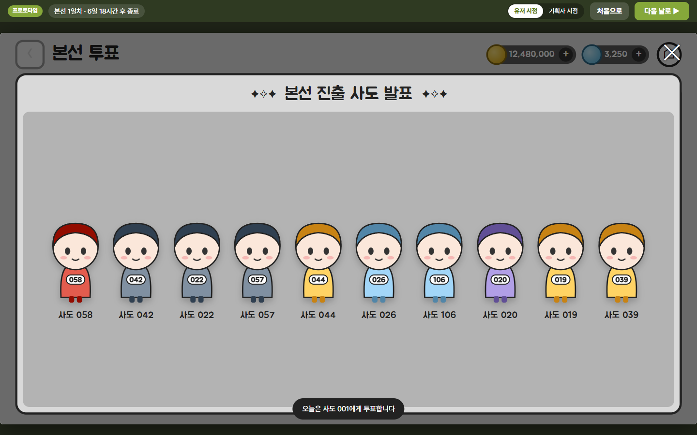
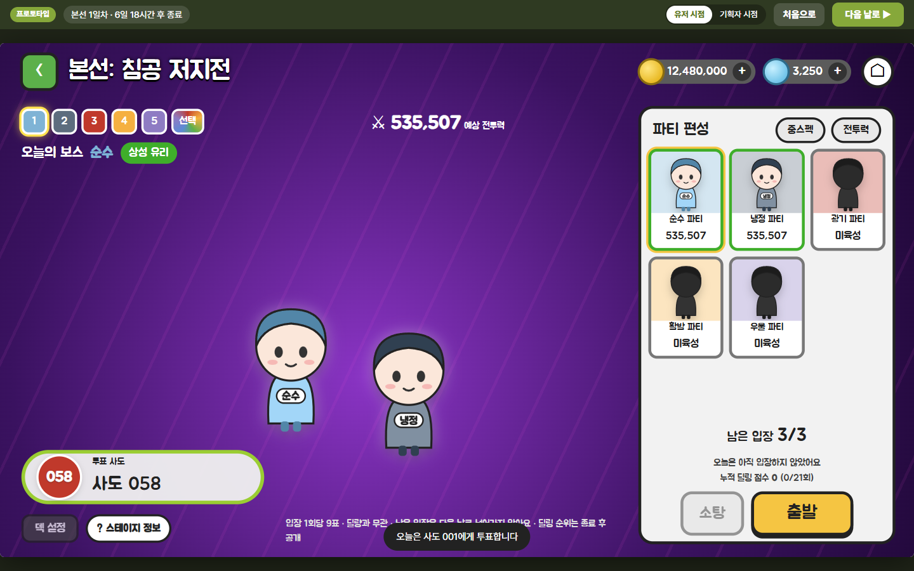
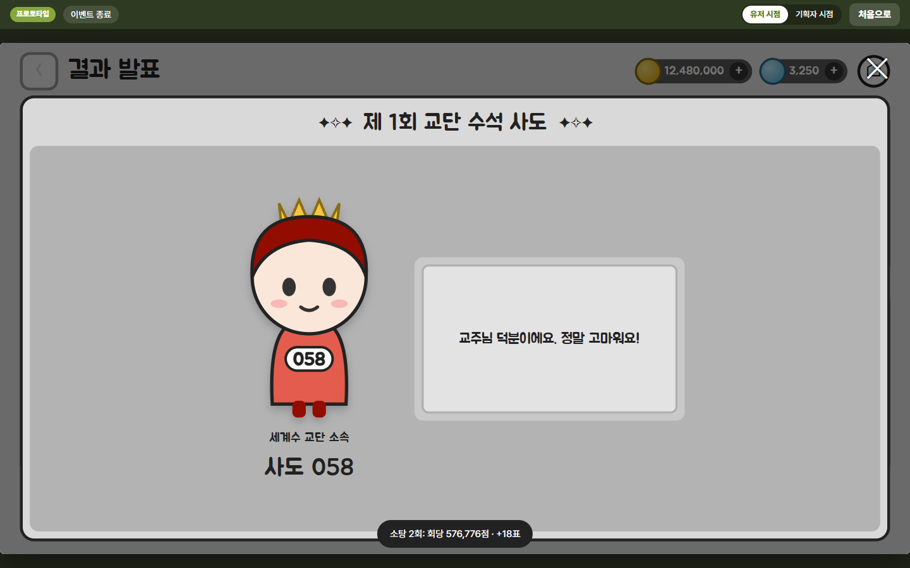
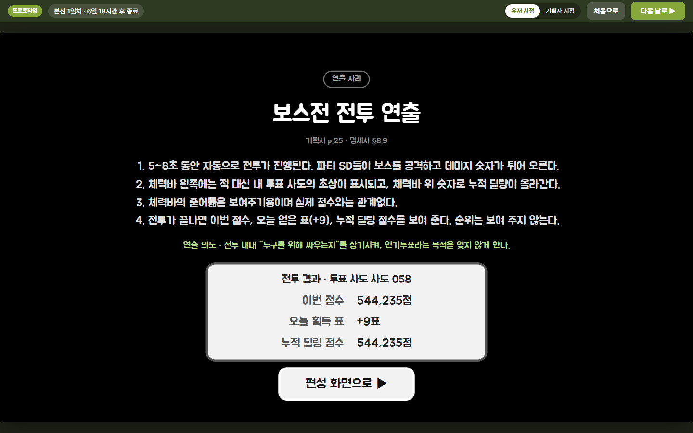
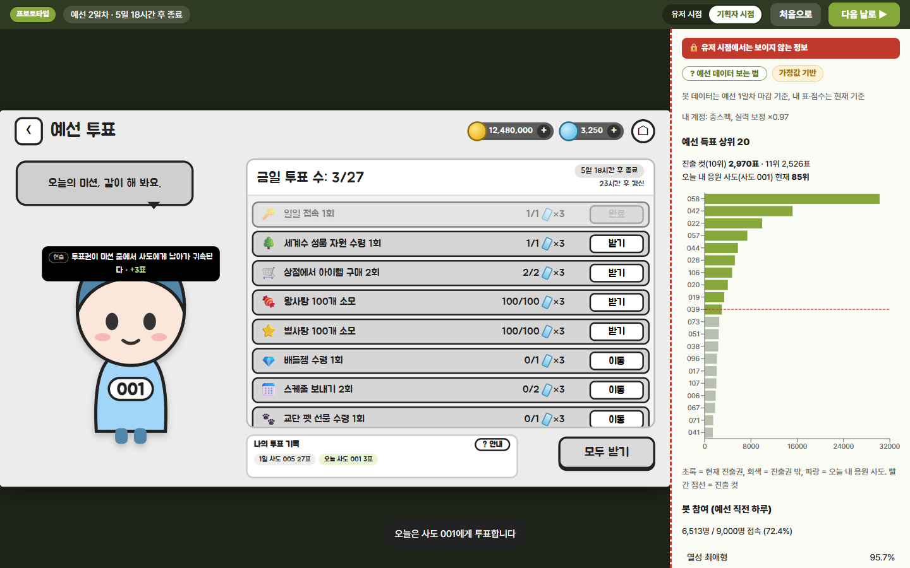
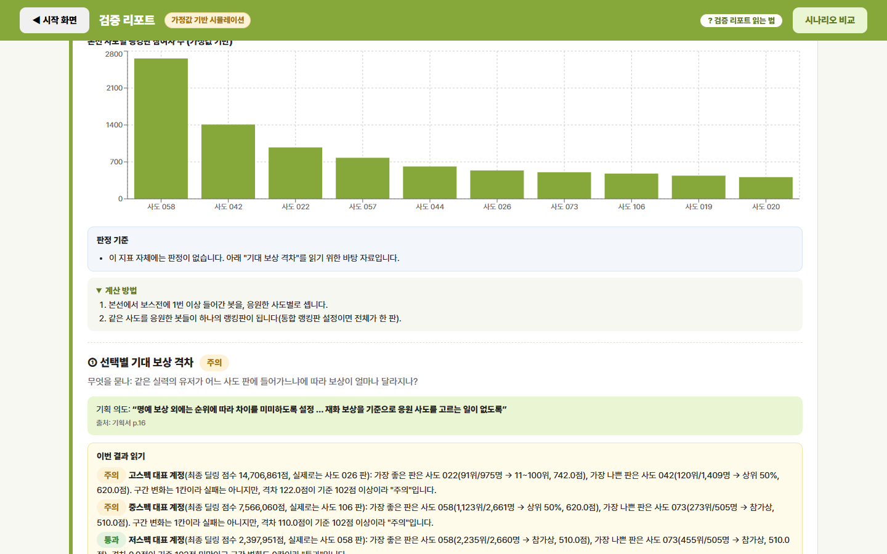
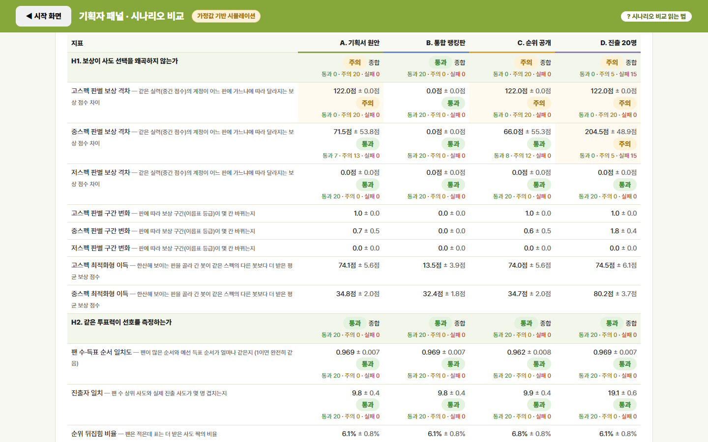

# 세계수 교단 수석 사도 투표 — 인기투표 콘텐츠 프로토타입 & 검증 도구

수집형 RPG를 위해 기획한 **2주짜리 캐릭터 인기투표 이벤트**를 직접 플레이해 보고, **봇 1만 명 시뮬레이션으로 기획 의도가 실제로 달성되는지 검증**하는 플레이어블 프로토타입입니다.

**▶ 바로 열기: https://aedli.github.io/sado-vote-proto/** (PC 화면 권장, 설치·로그인 없음)

작성: 김두현 · willy0429@naver.com



---

## 어떤 콘텐츠인가

교주(플레이어)가 사도 114명 중 한 명을 응원해 "수석 사도"를 뽑는 2주 이벤트입니다.

| | 1주차 예선 | 2주차 본선 |
|---|---|---|
| 표 얻는 법 | 일일 미션 9개 × 3표 (하루 27표) | 보스전 입장 하루 3회 × 9표 (딜량 무관) |
| 응원 사도 | 매일 다시 고름 (하루 한 명) | 처음 정하면 끝까지 변경 불가 |
| 결과 | 상위 10명 본선 진출 | 득표 1위가 수석 사도 |
| 공개 범위 | 순위·득표 전면 비공개 | 딜링 순위 비공개 (종료 후 발표) |

- **모든 계정의 투표력이 같습니다.** 표는 스펙·과금·보유와 상관없이 참여 횟수로만 주어집니다(최대 378표).
- **애정 표현은 딜링 순위로 분리했습니다.** 본선에서는 같은 사도를 응원한 사람끼리 딜량으로 겨뤄 명예 보상(이름표)을 받습니다.
- **이월이 없습니다.** 그날 받지 않은 표와 입장 횟수는 사라집니다.

## 무엇을 검증하나

기획서의 핵심 주장 세 가지를 가설로 세우고, 지표와 판정 기준(통과·주의·실패)을 붙였습니다.

| 가설 | 기획 의도 | 주요 지표 |
|---|---|---|
| **H1** 보상이 사도 선택을 비틀지 않는가 | "재화를 기준으로 응원 사도를 고르는 일이 없어야 인기투표가 성립" | 같은 실력의 계정이 판에 따라 받는 보상 차이, 판을 골라 간 봇의 실제 이득 |
| **H2** 같은 투표력이 인기를 제대로 보여주는가 | 순위 비공개로 사표 회피를 막아 "실제 선호를 측정" | 팬 수와 득표의 순서 일치도, 진출자 일치, 순위 뒤집힘과 열성 팬층의 영향 |
| **H3** 최애가 예선에서 떨어진 유저도 본선에 남는가 | 후보를 10명으로 압축해 판 밀도 유지, 예선 참여자의 본선 이탈 방지 | 최애 탈락 비율, 본선 이탈률, 랭킹판 크기 |

## 어떻게 검증하나

- **봇 1만 명**이 플레이어와 같은 규칙으로 2주를 보냅니다. 봇은 열성 최애형·라이트 팬형·다최애 분산형·보상 최적화형·루틴 무관심형·중도 진입형 6가지 성향으로 나뉩니다.
- 봇의 성향과 확률은 실제 데이터가 아닌 **가정값**입니다. 화면에서 직접 바꿔 가며 결과가 얼마나 흔들리는지 볼 수 있습니다.
- 전투는 구현하지 않고 **딜량 공식**(스펙 × 성격 상성 × 실력 × 운)으로 계산합니다.
- 모든 무작위는 **시드 기반**이라, 같은 시드·설정이면 결과가 항상 같습니다.
- 대안 규칙(통합 랭킹판, 순위 공개, 진출 20명, 예선 사도 고정)을 **같은 20개 시드에서 반복 실행**해 나란히 비교합니다.

## 주요 검증 결과

봇 1만 명 × 20회 반복 평균입니다. 가정값 기반이므로 "이 가정이 맞다면"으로 읽어야 합니다.

| | 기획서 원안 | 통합 랭킹판 | 순위 공개 | 진출 20명 |
|---|---|---|---|---|
| **H1 종합** | 주의 | **통과** | 주의 | 주의 (20회 중 15회 실패) |
| 고스펙 판별 보상 격차 | 122점 | 0점 | 122점 | 122점 |
| 중스펙 판별 보상 격차 | 72점 (20회 중 13회 주의) | 0점 | 66점 | **205점** |
| 고스펙 최적화형 이득 | +74점 | **+13점** | +74점 | +74점 |
| **H2** 팬 수·득표 순서 일치도 | 0.969 | 0.969 | 0.962 | 0.969 |
| 예선 득표 쏠림 (지니) | 0.690 | 0.690 | **0.748** | 0.690 |
| **H3** 최애 탈락 비율 | 45.0% | 45.0% | 45.0% | **32.4%** |
| 본선 이탈률 | 11.5% | 11.5% | 11.4% | **8.3%** |
| 가장 작은 랭킹판 | 442명 | 8,818명 (한 판) | 443명 | **179명** |

**읽을 수 있는 것**
- **H1 (주의):** 사도별 랭킹판은 판 크기 차이(가장 큰 판 약 2,660명 vs 가장 작은 판 약 440명) 때문에, 중상위 실력 계정은 판 선택만으로 보상 구간이 한 칸 바뀝니다. 판을 노리고 옮긴 봇은 실제로 이득을 봤습니다. 통합 랭킹판은 이 문제를 없애지만 "내 사도를 위해 겨룬다"는 애정 표현 구조를 잃습니다. 보상 구간 설계를 보완할 여지가 있다는 신호입니다.
- **H2 (통과):** 같은 투표력에서 득표는 팬 수 순서를 잘 따릅니다. 순위를 공개하면 표가 상위 사도로 더 쏠려(지니 0.690 → 0.748) 기획서의 "사표 회피" 우려와 같은 방향이 나타납니다.
- **H3 (통과):** 최애가 탈락한 봇이 45%여도 본선 이탈은 11.5%에 그칩니다. 진출 인원을 20명으로 늘리면 이탈은 줄지만 판이 잘게 쪼개져 H1(판 선택에 따른 보상 차이)이 크게 나빠집니다. 10명 정원이 두 목표 사이의 균형점으로 보입니다.

## 화면 구성

**1. 플레이어 흐름** — 교주가 되어 14일을 직접 진행합니다. 화면 배치는 기획서의 화면 예시를 따랐고, 유저 시점에는 순위·득표·판 규모가 어디에도 나오지 않습니다.

| 예선 사도 선택 | 예선 미션 |
|---|---|
|  |  |
| **본선 진출 공지** | **보스전 편성** |
|  |  |
| **결과 발표** | **연출 설명 카드** |
|  |  |

- 연출(이벤트 시작, 보스 침공, 전투, 시상식, 결과 발표)은 애니메이션 대신 **검은 화면의 연출 설명 카드**로 "어떤 연출이 어떤 의도로 나오는지"를 보여줍니다.

**2. 기획자 시점** — 플레이 중 위쪽 토글을 켜면 유저에게 숨겨진 실시간 득표·진출 컷·랭킹판 규모·내 실제 딜링 순위를 함께 볼 수 있습니다.



**3. 검증 리포트** — 플레이 없이 14일을 즉시 돌려 H1~H3 지표와 판정을 보여줍니다. 지표마다 기획 의도, 계산 방법, 판정 기준, "이번 결과 읽기"가 쉬운 문장으로 붙어 있고, 봇 가정값을 바꿔 다시 돌릴 수 있습니다. (첫 화면은 맨 위 대표 이미지 참고)



**4. 기획자 패널 · 시나리오 비교** — 기본 시나리오 중 최대 4개를 골라 같은 시드들로 반복 실행하고, 지표마다 평균 ± 흔들림 폭, 평균 기준 판정, 통과·주의·실패 횟수를 나란히 비교합니다. 판정 기준과 시나리오별 가정값을 바꿀 수 있고, 설정은 JSON으로 내보내고 불러올 수 있습니다.



## 직접 실행하기

[Node.js](https://nodejs.org/) 20 이상이 필요합니다.

```bash
npm install
npm run dev        # 개발 서버 (http://localhost:5173)
npm run test       # 단위 테스트 (규칙 엔진·봇·지표·시나리오)
npm run build      # 배포용 빌드 (dist/)
npm run sim        # 14일 시뮬레이션 결과를 명령줄로 (--seed, --bots, --public, --fixed, --board unified, --finalists)
npm run report     # 검증 리포트 지표를 명령줄로
npm run compare    # 기본 시나리오 4개 비교를 명령줄로 (--repeats, --bots, --seed)
```

`main` 브랜치에 올리면 GitHub Actions가 테스트를 통과한 경우에만 GitHub Pages에 자동 배포합니다.

## 프로젝트 구조

```
docs/SPEC.md        개발 명세서 (단일 기준 문서, 부록 B에 기획 의사결정 기록)
src/config/         규칙·보상·봇 가정값·판정 기준·화면 문구·사도 데이터 (숫자와 문구는 모두 여기)
src/engine/         규칙 엔진: 예선·본선·딜량·순위·보상 (React 없음, 순수 로직)
src/sim/            봇 집단·행동·하루 진행·지표·시나리오 비교 (React 없음, Web Worker에서 실행)
src/screens/        화면 (플레이어 흐름, 검증 리포트, 시나리오 비교)
src/components/     공통 UI
src/store/          상태 관리 (Zustand)
tests/              Vitest 단위 테스트
```

**설계 원칙**
- 규칙 엔진과 시뮬레이션은 화면과 완전히 분리되어 헤드리스로 돌아가고, 화면은 결과를 읽기만 합니다.
- 유저 시점 데이터와 기획자 시점 데이터를 아예 따로 만들고, "유저 시점에 순위·득표가 없다"를 테스트로 확인합니다.
- 기획 판단이 필요한 지점은 구현 전에 확인받아 명세서 부록에 기록했습니다.

## 캐릭터 교체

캐릭터 이름·소속·대사는 `src/config/saints.json`에서, 이미지는 `public/assets/saints/`에 파일을 넣고 `saints.json`의 `image` 경로를 지정해 바꿀 수 있습니다. 지정하지 않으면 자리표시 그림으로 그립니다.

## 기술 스택

React 18 · TypeScript · Vite · Zustand · Recharts · Vitest · Web Worker · GitHub Actions / Pages

---

이 저장소는 게임 콘텐츠 기획 포트폴리오용 개인 프로젝트입니다. 특정 게임의 캐릭터 이름·이미지는 사용하지 않았으며, 화면의 캐릭터는 모두 자리표시입니다. 원본 콘텐츠 기획서는 별도로 제공합니다.
